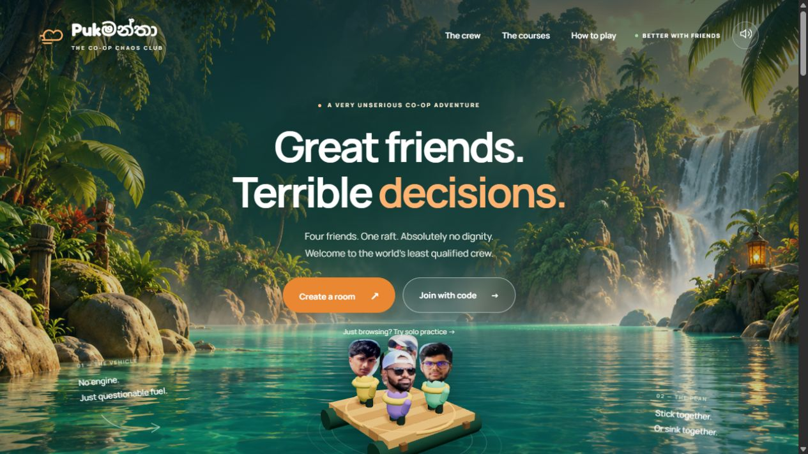
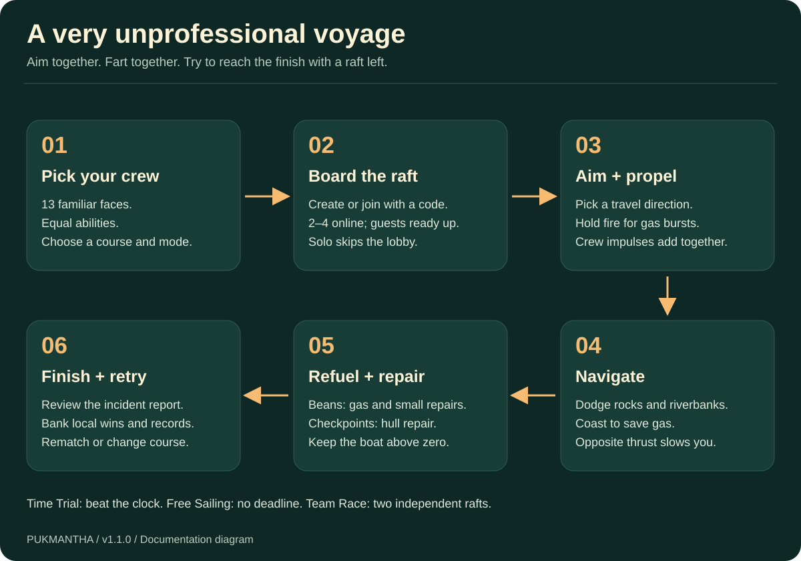
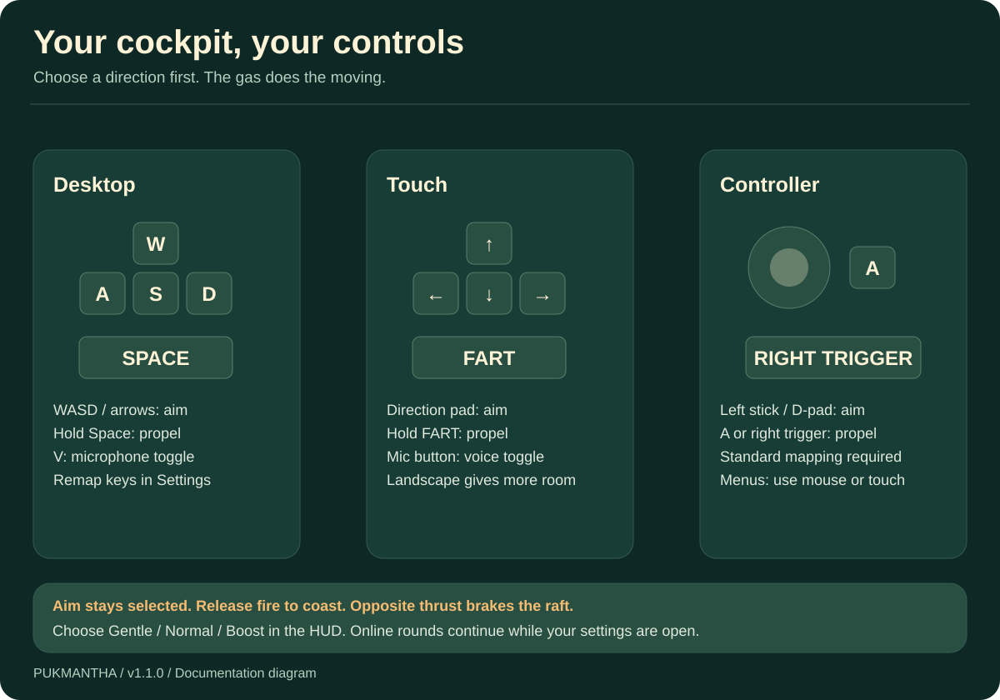
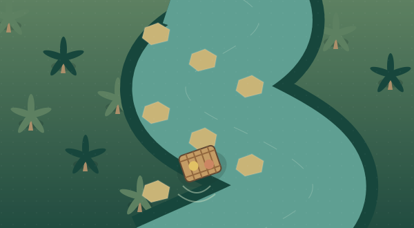
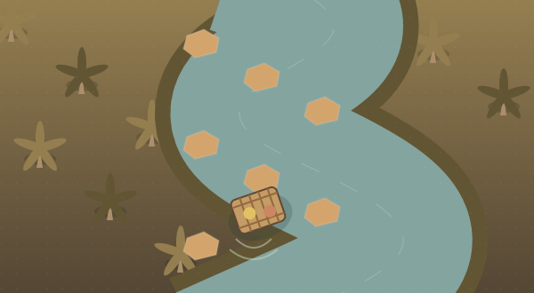
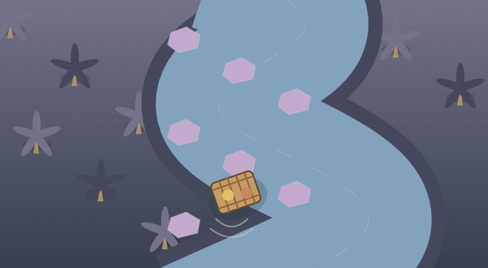
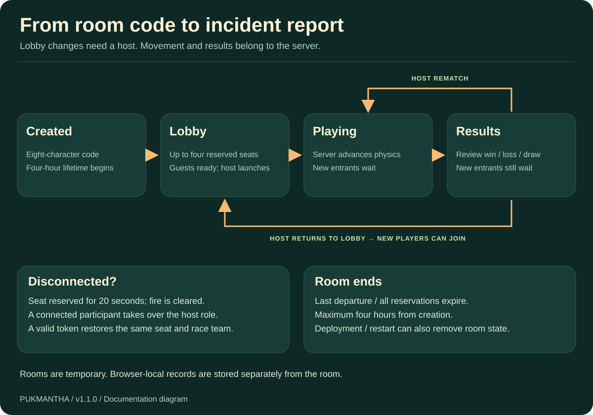
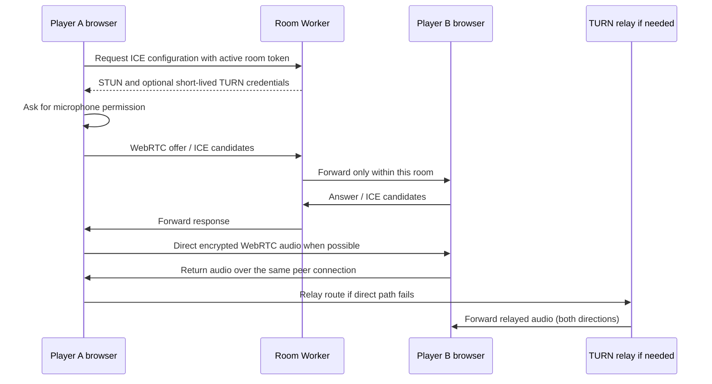
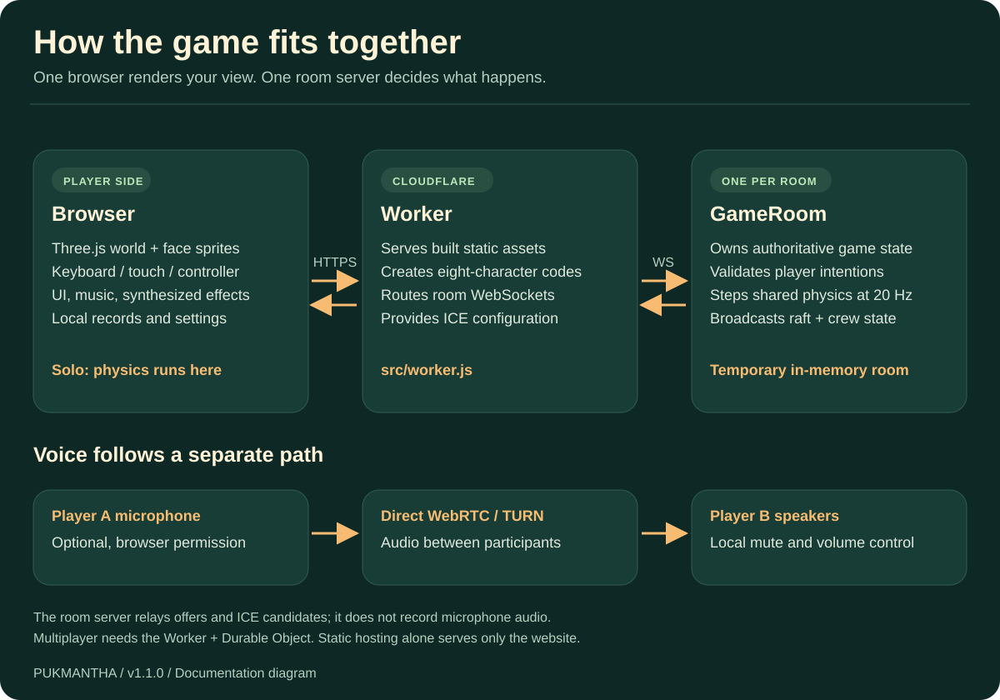

# Pukමන්තා

### Great friends. Terrible decisions.

**A cartoon 3D browser party game for one solo captain or 2–4 online players.** Pick a familiar face, board a raft, and use wildly unprofessional propulsion to survive the river. Everyone can join through a website and room code, on separate networks, without installing a game client.



**Version:** 1.1.0 · **Players:** solo / 2–4 online · **Platform:** modern desktop and mobile browsers · **Hosting:** Cloudflare Workers + Durable Objects · **Voice:** optional WebRTC audio

This repository contains the complete game source, all 13 supplied character photos, the two supplied MP3 tracks, original visual assets, automated tests, deployment helpers, and documentation. It is prepared for uploading to GitHub with `README.md`, `package.json`, and `wrangler.jsonc` at the repository root.

> **Hosting essentials:** multiplayer needs the included Cloudflare Worker and Durable Object. Uploading the static website to GitHub Pages or a static Cloudflare Pages upload alone will not create the room server. The GitHub source folder excludes generated `dist/` and dependencies; run the build before deploying.

## Contents

- [What is this game?](#what-is-this-game)
- [Features and scope](#features-and-scope)
- [How to play](#how-to-play)
- [Game modes](#game-modes)
- [Controls and settings](#controls-and-settings)
- [Characters and faces](#characters-and-faces)
- [Courses](#courses)
- [Physics and scoring](#physics-and-scoring)
- [Multiplayer rooms](#multiplayer-rooms)
- [Live voice chat](#live-voice-chat)
- [Music and sound effects](#music-and-sound-effects)
- [Quick local setup](#quick-local-setup)
- [Upload this folder to GitHub](#upload-this-folder-to-github)
- [Deploy to Cloudflare](#deploy-to-cloudflare)
- [Configure TURN for voice](#configure-turn-for-voice)
- [Architecture](#architecture)
- [Project structure](#project-structure)
- [Network protocol](#network-protocol)
- [Browser data and privacy](#browser-data-and-privacy)
- [Development and customization](#development-and-customization)
- [Tests and release checks](#tests-and-release-checks)
- [Troubleshooting](#troubleshooting)
- [Known limits](#known-limits)
- [Credits and asset rights](#credits-and-asset-rights)
- [Further documentation](#further-documentation)

## What is this game?

Pukමන්තා is an original browser implementation of a cooperative fart-powered rafting idea. Its comedy comes from the character job titles, questionable teamwork, dramatic sound effects, emotes, and end-of-round incident reports.

In cooperative modes, the crew shares **one raft**. Every player chooses a direction and fires bursts that push that raft. Agree on a direction and you move together; disagree and you spend your gas arguing with physics. Collect golden beans, dodge rocks, repair the hull at checkpoints, and reach the finish.

Team Race places the crew on **two independent ghost rafts**. With two players it is 1v1; with four it is 2v2. Papaya and Mint race to the same finish without colliding with each other.

The art combines a real-time Three.js world, original cartoon bodies, and face sprites made from the supplied photos. The landing page uses tropical artwork and a searchable character roster. The game takes inspiration from the user-supplied [Fart Together Demo reference](https://store.steampowered.com/app/5208630/Fart_Together_Demo/); it has its own code, physics, assets, and browser multiplayer implementation. It is not the Steam game or an official port.

## Features and scope

| Area | Included behavior |
| --- | --- |
| Play | Solo practice, online co-op, Free Sailing, and 1v1 / 2v2 Team Race |
| Crew | 13 selectable named characters with original photo faces and cartoon bodies |
| Courses | Beanwater Bay, Curry Rapids, and The Final Flush |
| Multiplayer | Eight-character room codes, invite links, up to four seats, ready checks, host migration, and brief reconnect reservations |
| Voice | Optional microphone, mute toggle, local peer mute, voice volume, speaking indication in the lobby, STUN and optional TURN |
| Controls | Keyboard, persistent key remapping, touch direction pad, hold-to-fire button, and standard gamepad gameplay controls |
| Audio | Supplied background music, supplied defeat track, synthesized fart bursts, pickup and victory chimes |
| Progress | Local wins, course completion, Time Trial best times by crew size, and two unlockable raft trims |
| Comfort | Separate audio sliders, camera distance, reduced effects and camera motion |
| Presentation | 3D river, palms, rocks, beans, gas particles, cartoon crew, race standings, emotes, and blame reports |
| Delivery | Source, asset licenses, tests, GitHub CI workflow, Cloudflare configuration, deployment helpers, and release packager |

## How to play

1. **Choose your character.** Scroll to the crew roster or search for a name. All characters are available immediately and have equal abilities.
2. **Choose a destination and mode.** Start with Beanwater Bay and Time Trial to learn the controls.
3. **Practice or assemble a crew.** Solo practice starts immediately. For multiplayer, create a room and share its code or copied invite link.
4. **Join and ready up.** Friends open the same deployed website, choose a character, and join. Guests press **Ready up**. The host launches once the crew is ready.
5. **Aim, then fart.** Aim in the direction you want the raft to travel. Hold the fire control for repeated bursts while you have enough gas.
6. **Read the river.** Coast when you can, use opposite thrust to brake, and steer around rocks. Golden beans refill gas and repair the raft.
7. **Finish or file an incident report.** Reach the finish before the deadline and before the hull fails. Review the beans, emissions, time, and most enthusiastic contributor.
8. **Play again.** The host can rematch directly or return everyone to the lobby to change the course, mode, or crew.



### Read the HUD

| HUD item | Meaning |
| --- | --- |
| Course and progress | Your raft's forward progress along the selected course, capped at 100% |
| Time to regret | Countdown in Time Trial and Team Race |
| Time well wasted | Elapsed time in Free Sailing, which has no deadline |
| Raft integrity | Shared hull health for your boat; collisions reduce it |
| Personal gas | Your own fuel; firing consumes it and it regenerates automatically |
| Beans rescued | Pickups collected by your boat |
| Thrust power | Gentle, Normal, or Boost; higher power costs more gas |
| Race standings | Separate progress for Papaya and Mint, with your team identified |
| Mic / Settings / Exit | Voice toggle, comfort and controls settings, and leave game |

**Aiming alone does not move the raft.** Releasing fire stops new bursts, but the raft keeps coasting. The last aiming direction stays selected after you release a direction key or touch button.

## Game modes

| Mode | Players | Objective | End conditions |
| --- | --- | --- | --- |
| Time Trial (`trial`) | 1 in practice; 2–4 online | Cooperate on one raft and beat the course deadline | Finish wins; empty hull or elapsed deadline loses |
| Free Sailing (`free`) | 1 in practice; 2–4 online | Cooperate on one raft without a countdown | Finish wins; empty hull loses; the timer shows elapsed time |
| Team Race (`race`) | Exactly 2 or 4 online | First of two rafts to cross the finish | First finish wins; both boats failing loses the round; an exact crossing tie is a draw |

### Team Race details

- Players are assigned alternately by connection order: Papaya, Mint, Papaya, Mint. There is no manual team picker.
- Each raft has its own hull, gas crew, collected beans, and course timer.
- The two rafts are ghosts to each other: they do not collide or steal each other's pickups.
- Team assignments survive a valid mid-round reconnect.
- A sunk crew watches the remaining boat. Its controls cannot keep firing after it is out.
- If both boats cross during one simulation tick, their interpolated crossing times decide the winner. Equal crossing times within the comparison tolerance produce a draw.
- Voice chat is **room-wide**, including both teams.
- Choosing Team Race and then solo practice falls back to Time Trial because a race needs another player.

## Controls and settings



| Action | Desktop default | Mobile / touch | Standard gamepad |
| --- | --- | --- | --- |
| Aim forward | W or ↑ | Up direction button | Left stick up or D-pad up |
| Aim backward | S or ↓ | Down direction button | Left stick down or D-pad down |
| Aim left / right | A / D or ← / → | Left / right direction buttons | Left stick or D-pad |
| Fart / propel | Hold Space | Hold **FART** | Hold A / primary button or right trigger |
| Toggle microphone | V, or the Mic button | Mic button | Use screen controls |
| Choose thrust power | HUD selector | HUD selector | Use screen controls |
| Settings and menus | Mouse / touch; normal browser focus navigation | Touch | Use mouse or touch |

Keyboard diagonal aiming is normalized so it does not add extra power. Gamepad input uses the browser's standard mapping with a 0.2 stick deadzone. Stick magnitude does not replace the thrust-power selector. Keyboard direction takes priority when both keyboard and controller direction are active.

### Customize your cockpit

Open **Settings** to adjust music, fart and round sounds, voice volume, camera distance, and reduced effects. The camera-distance range is 0.8–1.35. This is a following camera, not a free-look camera.

Select a binding, then press a replacement key. Escape cancels rebinding. Arrow keys always remain available and are reserved. Conflicting keys, modifiers, and unsupported inputs are rejected. **Restore default keys** resets the custom bindings.

Opening a dialog, losing focus, or hiding the page clears held firing input. Solo practice pauses behind dialogs and while the document is hidden. **Online play continues** because the other players and server are still playing. A gamepad trigger must be released after an input reset before it can fire again.

Landscape orientation gives phones more room for the HUD and touch controls. The game does not force orientation or require an app installation.

## Characters and faces

Names preserve the supplied image filename stems, including capitalization and parentheses. The job titles are jokes; they do not change speed, gas, health, or damage.

| ID | Character name | Questionable job title | Photo asset |
| ---: | --- | --- | --- |
| 0 | Adma Ribishek | Chief Wind Officer | `face-0.jpg` |
| 1 | Wanigarathana Shuurin | Director of Bad Ideas | `face-1.jpg` |
| 2 | Nipun Putha | Captain of Questionable Decisions | `face-2.jpg` |
| 3 | Pasindu son | Head of Sudden Acceleration | `face-3.jpg` |
| 4 | Sachin Thundulkar | Senior Gas Consultant | `face-4.jpg` |
| 5 | Die Yabala (podieka) | Junior Chaos Engineer | `face-5.jpg` |
| 6 | Die Yabala (lokueka) | Executive Chaos Engineer | `face-6.jpg` |
| 7 | Oscar Oshitha | Best Supporting Farter | `face-7.jpg` |
| 8 | Shan Putha Lite | Lightweight. Heavy Consequences. | `face-8.jpg` |
| 9 | Goja Bro | Quality Out-of-Control | `face-9.jpg` |
| 10 | Saragee Yohan | Chief Vibes Department | `face-10.jpg` |
| 11 | Mr Anjana | Silent But Employed | `face-11.jpg` |
| 12 | Pola | Minister of Propulsion | `face-12.jpg` |

### How the face treatment works

Each entry in `CAST` in [src/shared.js](src/shared.js) includes a normalized crop rectangle `[x, y, width, height]`, color, and title. [src/render.js](src/render.js) draws the selected region into a masked head texture. That texture becomes a camera-facing sprite on an original cartoon body.

The visible head uses the original photographed face pixels. It is not a reconstructed 3D face, a generated replacement likeness, or facial animation. The body and raft are original scene geometry. A photo with sunglasses or a side profile retains that appearance.

The underlying JPG files remain the supplied photo assets, which may include more of the original photograph than the visible head crop. They are shipped as public static assets. Cropping the display does **not** remove that content from the downloadable files.

Each room reserves a unique character per seat. If the requested character is already occupied on initial join, the server selects an unused one. Trying to change to a taken character is rejected. A disconnected reserved seat keeps its character during the reconnect grace period.

## Courses

The illustrations below are the game's destination artwork. They communicate the course theme; they are not exact navigation maps.

| Beanwater Bay | Curry Rapids | The Final Flush |
| --- | --- | --- |
|  |  |  |
| A gentle introduction to poor decisions. | The meeting could have been an email. | HR has left the chat. |
| 150 distance units · 150 seconds | 210 distance units · 180 seconds | 250 distance units · 210 seconds |
| River half-width: 12 | River half-width: 10 | River half-width: 9 |
| 10 generated rock entries | 14 generated rock entries | 18 generated rock entries |

The physical course is deterministic. The centerline curves with two sine waves, and selected rocks oscillate sideways. The listed rock entries are generated course objects, not a promise that every entry must be crossed before the finish. The `seed` fields currently do not drive random course generation.

Free Sailing uses the same course geometry with no deadline. Team Race uses the selected course's countdown for both boats.

## Physics and scoring

Physics is shared between solo practice and the authoritative multiplayer server through [src/shared.js](src/shared.js). It is a deliberately lightweight arcade simulation, not a general-purpose rigid-body physics engine.

| Mechanic | Implemented value / behavior |
| --- | --- |
| Starting hull | 100 per raft |
| Starting / maximum personal gas | 100 |
| Gas regeneration | 12 units per second |
| Burst cooldown | 0.38 seconds per player |
| Gentle | Power 0.6; costs 9 gas per burst |
| Normal | Power 1.0; costs 15 gas per burst |
| Boost | Power 1.4; costs 21 gas per burst |
| Burst impulse | `5.8 / sqrt(active crew size) × power`, along normalized aim |
| Speed limit | 13 game-distance units per second |
| Drag | Velocity multiplied by `0.48 ** dt` each step |
| Collision damage | 16 hull, with a 1.2-second damage cooldown |
| Bean pickup | +20 gas to each active member of that boat and +4 hull, capped at 100 |
| Checkpoint | +8 hull at qualifying 50-unit progress thresholds, before the final 10 units |
| Server loop | Nominal 50 ms / 20 updates per second; simulation delta capped at 0.1 s |

Multiple players firing together add their thrust vectors. Opposite directions can cancel. Crew-size scaling keeps a larger crew from simply multiplying solo speed without limit, and the overall speed cap still applies.

Golden beans alternate around the centerline every 12 units, starting at distance 8. A raft can collect each bean only once. A checkpoint is a repair event: **it is not a respawn location or saved game**.

The simulation tests finish crossing before the loss condition in the same step. A finish reached in that step therefore wins even if the clock or hull also reaches its limit during the step. Round-end states stop further physics updates.

### Results, records, and unlocks

- Results show beans collected, crew emissions (successful bursts), elapsed round time, and a playful contribution report sorted by bursts.
- A win increments the local win count and marks that course complete. A race draw does not award a personal win or play the defeat track.
- Successful **Time Trial** times are stored by course and crew size. Free Sailing and Team Race do not overwrite these best times.
- The first win unlocks **Golden Gas** raft trim. Winning all three courses unlocks **Mint Condition**.
- Cosmetics are a preference on the current browser, not a synchronized account inventory.
- A list of the latest 100 recorded round IDs prevents the same result from being counted again on ordinary reload/reconnect.
- There is no online global leaderboard or separate points economy. The internal combo counter does not add a visible score multiplier.

## Multiplayer rooms



### Joining from different networks

The host and friends open the same **deployed HTTPS URL**. The host creates a room, then shares either the eight-character code or an invite link shaped like `https://YOUR-GAME.example/?room=ABCDEFGH`. Friends may use PCs or phones on different internet connections. They do not need to share Wi-Fi, configure port forwarding, or run the server themselves.

`127.0.0.1` and `localhost` point to the current device. Sending a local development URL to a friend's phone will not connect it to your computer. Deploy to Cloudflare for the intended internet-play workflow.

### Rules and lifecycle

- A room has at most four seats. Online rounds require at least two connected players. Use practice when playing alone.
- The first connected participant becomes host. The host selects course/mode and launches rounds; guests must ready up for a new lobby round.
- Changing course or mode clears readiness and any completed round. Everyone checks the new choice before launching.
- New entrants cannot join during an active round **or while results are still open**. The host must return to the lobby first. Existing valid seats can reconnect to their results.
- A disconnected seat is reserved for **20 seconds**. It counts toward room capacity until the reservation expires.
- The client attempts reconnects with 1-, 2-, then 3-second delays. An initial connection waits up to 10 seconds for its welcome message.
- Host ownership moves to a connected player if the host disconnects. Returning does not automatically take host status back.
- The server clears firing after 700 ms without fresh input, limiting stuck thrust during a stalled connection.
- A room lasts at most **four hours from creation**. An empty room closes once its remaining seats are removed; the final voluntary departure closes it immediately.
- Reconnect identity is kept in the current tab's session storage. Reusing that same identity in another tab replaces the old socket; use a fresh room join for a separate player.
- Host rematches from completed results do not require guests to re-ready. Returning to the lobby resets readiness.

Rooms are temporary in-memory objects. Although the Durable Object class is provisioned through a SQLite-class migration, this game does not write room state to SQLite. Deployment, restart, or object eviction can end the room. Records stored in browsers are separate and survive normal room closure.

## Live voice chat

Voice is optional and starts **off**. After joining a room, press **Enable voice** or the microphone control and grant browser microphone permission. Other participants must enable voice too. V toggles your microphone by default.

The browser captures audio only, with requested echo cancellation, noise suppression, and automatic gain control. No webcam is requested. Use the voice-volume slider to adjust incoming audio and peer controls to mute someone locally. Muting a peer does not mute them for everybody.



The Worker forwards connection setup messages; it does not carry or record the microphone audio. Audio travels between browsers or through the configured TURN relay. Four players create up to six peer connections in a mesh. This suits the four-player scope; it is not an unlimited conference system.

Without TURN secrets, the server supplies Cloudflare STUN only. That may work on permissive networks, but restrictive routers and mobile networks can need a relay. The client shows whether relay configuration is available; availability alone does not prove that a call is using the relay.

Leaving closes peer connections and stops local microphone tracks. Voice has no recording or transcription feature. Opening an HTTPS page or localhost is required for the intended microphone permission flow. See [Configure TURN for voice](#configure-turn-for-voice).

## Music and sound effects

| Sound | File / implementation | When it plays |
| --- | --- | --- |
| Background | `public/assets/background.mp3`, supplied as **Background sounds.mp3** | Loops after a user interaction; pauses when the page is hidden or the player loses |
| Defeat | `public/assets/lose.mp3`, supplied as **IF we lost the game play this.mp3** | Plays when the local player / team loses |
| Fart bursts | Procedural Web Audio noise and oscillator synthesis in `src/client.js` | When a new propulsion burst is observed |
| Pickups / victory | Procedural chimes | Bean pickups and successful round feedback |

Music, effects/round sounds, and voice have separate sliders. The effects slider also controls the supplied defeat track. Background music drops to 40% of the chosen music volume while voice is enabled. Browser autoplay rules mean sound begins after interaction; a silent first page load is expected.

The fart effects vary in pitch and duration. They are generated locally and do not require a separate downloaded sound pack. Audio settings are saved in the current browser.

## Quick local setup

### Requirements

- Node.js **22 or newer** and npm. The repository includes `.node-version` set to `22`.
- Internet access for the initial dependency installation.
- A browser with JavaScript and WebGL for gameplay. Microphone access and WebRTC are needed only for voice.
- A Cloudflare account for deployment; a GitHub account only if you want repository hosting / connected builds.

Install Node from its [official download page](https://nodejs.org/en/download). Open a terminal in the folder containing `package.json`:

```sh
npm ci
npm run dev
```

Open **http://localhost:8787**. Keep the terminal running while playing locally. Stop it with Ctrl+C.

On Windows, double-click **START-GAME.cmd** for a guided local launch. It checks Node, installs dependencies if needed, then starts the game. If dependency versions change, run `npm ci` again before launching.

`npm run dev` builds the static site and starts Wrangler's local Worker/Durable Object runtime. For testing multiple seats locally, use separate fresh tabs or browser sessions and join the same code. No remote Cloudflare deployment is created by this command.

## Upload this folder to GitHub

### Option A — GitHub website

1. Create an empty GitHub repository, for example `pukmanta`. Choose visibility appropriate for the included photos and music.
2. Open **Add file → Upload files** (or the new repository's upload-existing-files link).
3. Upload the **contents** of this folder, preserving subdirectories. Do not upload only a ZIP and expect GitHub to unpack it.
4. Confirm `README.md`, `package.json`, `package-lock.json`, and `wrangler.jsonc` are at the top level, alongside `src/`, `public/`, `tests/`, `scripts/`, and `docs/`.
5. Include the dotfiles and `.github/workflows/ci.yml`. File dialogs can hide names starting with a dot; verify them in the repository afterward. If needed, add them separately or use Git below.
6. Commit the upload. Open the README on GitHub to check its images, links, and diagrams.

GitHub's web uploader accepts up to 100 files at a time and 25 MiB per file. This source package is sized for that workflow; future additions may require multiple batches or Git. The web uploader does not apply `.gitattributes` conversions. See [GitHub's upload documentation](https://docs.github.com/en/repositories/working-with-files/managing-files/adding-a-file-to-a-repository).

### Option B — Git from the terminal

Create an empty repository first, then replace `YOUR-USERNAME` and the repository name below with your own. These commands are instructions for you; preparing this folder has not published anything.

```sh
git init
git add .
git commit -m "Add Pukmantha browser game and documentation"
git branch -M main
git remote add origin https://github.com/YOUR-USERNAME/pukmanta.git
git push -u origin main
```

Run these commands inside this game's folder, not its parent Downloads directory. GitHub Desktop is also suitable if you prefer a graphical Git client.

### Repository hygiene

The upload folder intentionally contains no `node_modules/`, generated `dist/`, `.wrangler/`, `.git/`, account login sessions, `.env` files, `.dev.vars`, or TURN credentials. `.gitignore` keeps those files out of later commits.

The `private: true` field in `package.json` prevents accidental npm publication. It does **not** make a GitHub repository or deployed website private. Repository visibility and website access are separate settings.

## Deploy to Cloudflare

Use **Cloudflare Workers with Static Assets and a Durable Object**, as configured in [wrangler.jsonc](wrangler.jsonc). Cloudflare documents this hosting model in [Workers Static Assets](https://developers.cloudflare.com/workers/static-assets/).

### Option A — Windows deployment helper

Double-click **DEPLOY.cmd**. It checks Node, runs `npm ci`, runs the automated tests, opens Cloudflare login, then builds, validates assets, and deploys. Read any error before retrying. Success is the HTTPS address printed by Wrangler, not simply the helper window opening.

### Option B — Terminal

```sh
npm ci
npm run check
npx wrangler login
npm run deploy
```

On macOS/Linux you can also run `bash DEPLOY.sh`.

Wrangler uploads the Worker, built static assets, Durable Object binding, and initial class migration. Open the resulting HTTPS `workers.dev` address and create a test room. A custom domain can be configured later in the account.

### Option C — Connect GitHub to Cloudflare Workers Builds

1. Upload the source repository as described above.
2. In Cloudflare, create or connect a **Worker** using the GitHub repository. Grant the integration access to the intended repository.
3. Set the root directory to the repository root (`.`) when this folder's contents are uploaded at the top level.
4. Use Node **22 or newer**. Keep `.node-version` in the repository and check the runtime selected in build settings/logs. Cloudflare documents supported version files in its [build image guide](https://developers.cloudflare.com/workers/ci-cd/builds/build-image/).
5. Use the following commands. Cloudflare's build environment installs project dependencies before these commands; the lockfile should remain committed.

| Setting | Value |
| --- | --- |
| Worker name | `pukmantha`, matching `wrangler.jsonc`, or update both consistently |
| Build command | `npm run build` |
| Deploy command | `npx wrangler deploy` |
| Project root | `.` |
| Generated static assets | `dist/`, configured in Wrangler; do not configure a separate Pages output project |
| Production branch | Your chosen branch, commonly `main` |

Review the first build logs and published URL. Current dashboard navigation and build settings are described in [Cloudflare Workers Builds](https://developers.cloudflare.com/workers/ci-cd/builds/).

The included GitHub Actions workflow tests changes; it does not deploy or require Cloudflare account secrets. Cloudflare's connected build integration is a separate deployment route.

### What Wrangler provisions

```text
Worker: pukmantha
  main: src/worker.js
  compatibility_date: 2026-10-01
  ASSETS: static files from ./dist
  /api/*: routed through Worker first
  ROOMS: Durable Object binding to GameRoom
  v1 migration: create SQLite-backed GameRoom class
```

Keep the `ROOMS` binding and class export consistent. Do not casually rename the Durable Object class or delete migration history after deploying; review Cloudflare's migration guidance before changing those infrastructure identifiers.

### Release ZIPs and prebuilt deployment

The GitHub source folder is not a prebuilt site. To create a checked release ZIP after installing dependencies:

```sh
npm run package
```

The default output is `../Pukmantha-Cloudflare.zip`, with a `.sha256` sidecar. The archive contains a `pukmantha/` directory, source, generated `dist/`, assets, documentation, tests, helpers, and a per-file `CHECKSUMS.sha256` manifest. It excludes dependency folders and credentials.

Extract a release ZIP before using its deployment helper. In a release that already includes a verified `dist/`, `npm run deploy:prebuilt` validates those assets and deploys them without rebuilding; dependencies and Cloudflare authentication are still required. The ZIP is a deployable project bundle, not a static dashboard upload that replaces the Worker setup.

## Configure TURN for voice

TURN provides a relay when two browsers cannot connect directly. It improves network compatibility; it does not fix denied microphone permission or unsupported browser behavior.

1. Create a TURN key in your Cloudflare Realtime TURN configuration.
2. Obtain its **TURN key ID** and the bearer API token associated with that TURN key. Follow [Cloudflare's credential-generation guide](https://developers.cloudflare.com/realtime/turn/generate-credentials/).
3. In this project, configure Worker secrets with the exact names used by the server:

```sh
npx wrangler secret put TURN_KEY_ID
npx wrangler secret put TURN_API_TOKEN
```

Enter each value at its prompt. Keep them on the server; do not put them in `public/`, client JavaScript, screenshots, the README, or GitHub commits. Dashboard-configured Worker secrets can be used instead of the CLI prompts.

For local testing only, a `.dev.vars` file in the project root may contain:

```dotenv
TURN_KEY_ID="replace-with-your-turn-key-id"
TURN_API_TOKEN="replace-with-your-turn-api-token"
```

The file is ignored by Git and blocked by the release packager. The values above are placeholders, not working credentials. Restart the local development server after changing local secrets.

The server exchanges those secrets for ICE credentials with a requested one-hour lifetime. Successful configurations are cached per seat for 30 minutes; fallback STUN responses for 30 seconds. It requires an active room token and returns `Cache-Control: no-store`. If credential generation fails or no TURN URL is returned, it falls back to STUN.

For a deployed voice check, join from two physical devices on different networks, enable both microphones, and verify audio in both directions. Confirm mute, per-peer mute, reconnect, and leave behavior. Long calls may need voice reconnection after credential/network changes; automatic long-session ICE renewal is not implemented. Check current Cloudflare account limits and usage before wider hosting; this repository does not promise zero operating cost.

## Architecture



### Client

[src/client.js](src/client.js) manages screens, UI state, WebSocket lifecycle, results, settings, and sound. [src/controls.js](src/controls.js) merges keyboard, touch, and standard gamepad input. [src/render.js](src/render.js) renders the river and character scene with Three.js. [src/voice.js](src/voice.js) manages microphones and peer connections.

Solo practice advances the shared simulation inside the browser. Multiplayer sends direction, power, and firing intention to the server roughly every 60 ms while the animation loop is active. The client renders the received state with local smoothing; it does not authoritatively submit position, damage, or finish results.

### Worker and room authority

[src/worker.js](src/worker.js) routes static requests to `ASSETS` and API requests to a room. Each room code maps to one `GameRoom` Durable Object, keeping its connected participants and simulation state together. The room validates actions, steps the physics, and broadcasts state at a nominal 20 Hz during play.

The host controls lobby decisions, not the physics server. A host disconnect does not move simulation authority to another player's browser; only the host UI role changes.

### Build and dependencies

The application is vanilla JavaScript ES modules. Three.js is the runtime graphics dependency. esbuild bundles the browser code. Wrangler supplies Cloudflare development and deployment tooling, and `ws` supports the integration test client. `package-lock.json` records the resolved dependency versions used by `npm ci`.

The build copies `public/` into `dist/`, bundles the client into `dist/game.js`, and includes the Three.js license in `dist/licenses/three.txt`. Fonts are served locally. There is no React build, application database, Steam networking integration, account service, or external font CDN required by the game.

## Project structure

```text
pukmanta/
├── README.md                     This complete guide
├── GITHUB_UPLOAD.md              Short upload and deployment checklist
├── CONTRIBUTING.md               Development and review workflow
├── THIRD_PARTY_NOTICES.md        Asset ownership and dependency notices
├── VERIFICATION.md               Original 23 October game verification
├── package.json                  Commands and dependency ranges
├── package-lock.json             Reproducible dependency resolution
├── wrangler.jsonc                Worker, ASSETS, ROOMS, and migration config
├── DEPLOY.cmd / DEPLOY.sh         Guided deployment helpers
├── START-GAME.cmd                Windows local launcher
├── .node-version                Node 22 baseline
├── .gitignore / .gitattributes   Repository hygiene and file handling
├── .editorconfig                Text editing defaults
├── .github/workflows/ci.yml      Automated repository checks
├── src/
│   ├── client.js                 Screens, rooms, audio, results, storage
│   ├── controls.js               Keyboard, touch, gamepad, key remapping
│   ├── render.js                 Three.js scene and face-sprite rendering
│   ├── shared.js                 Cast, courses, modes, physics
│   ├── voice.js                  WebRTC audio connections
│   └── worker.js                 Cloudflare routes and GameRoom authority
├── public/
│   ├── index.html               Page, lobby, HUD, dialogs
│   ├── style.css                Base interface styles
│   ├── redesign.css             Landing-page styling
│   ├── landing.js               Landing-page interactions and search
│   └── assets/
│       ├── face-0.jpg … face-12.jpg
│       ├── background.mp3 / lose.mp3
│       ├── lagoon-hero.png
│       ├── course-bay.svg / course-rapids.svg / course-flush.svg
│       └── fonts/               Four font files and their OFL notices
├── scripts/
│   ├── build.mjs                Clean and generate dist
│   ├── check-assets.mjs         Required asset and reference validation
│   └── package.mjs              Deterministic ZIP and checksums
├── tests/                       Unit, simulation, and room integration tests
└── docs/
    ├── PROTOCOL.md              Endpoint and WebSocket reference
    ├── DOCUMENTATION_CHECKS.md   This package's verification scope
    ├── images/home.png          Actual landing-page screenshot
    ├── diagrams/                Architecture, flow, lifecycle, controls SVGs
    └── licenses/three-LICENSE.txt
```

`node_modules/`, `dist/`, and `.wrangler/` appear locally after installation/build/development. They are generated and ignored in the GitHub source repository.

## Network protocol

All room messages are JSON over WebSocket. The browser first creates or joins a room, receives its ID and reconnect token, then consumes authoritative snapshots.

| Route | Purpose |
| --- | --- |
| `POST /api/create` | Create a room and receive `{ "ok": true, "code": "…" }` |
| `GET /api/room/CODE?character=2` with WebSocket upgrade | Join a lobby seat |
| `GET /api/room/CODE?token=TOKEN` with WebSocket upgrade | Reconnect an existing seat |
| `GET /api/room/CODE/ice?token=TOKEN` | Retrieve ICE configuration for a connected room participant |
| Other static paths | Serve the built site from `ASSETS` |

Representative client messages:

```json
{"type":"input","x":0,"z":1,"fire":true,"power":1}
{"type":"ready","ready":true}
{"type":"mode","mode":"race"}
{"type":"start"}
```

Each line above is a separate message, not a single JSON document. Input `x` and `z` must be finite numbers within −1 to 1 and are normalized by the server. The server accepts only the three supported power values. Host-only commands and valid phases are checked server-side.

Full message tables, state shapes, error behavior, and signaling details are in [docs/PROTOCOL.md](docs/PROTOCOL.md).

The server rejects mismatched `Origin` headers when an Origin is present, limits each client's incoming message rate, ignores oversized or malformed payloads, prevents duplicate character selection, and prevents stale sockets from controlling a reconnected seat. These measures support the intended small private-room game; they are not a complete account-authentication or abuse-prevention platform.

## Browser data and privacy

| Storage key | Location | Purpose |
| --- | --- | --- |
| `puk-prefs` | `localStorage` | Audio levels, reduced effects, camera distance, chosen raft trim |
| `puk-character` | `localStorage` | Last selected character |
| `puk-controls-v1` | `localStorage` | Custom control bindings |
| `puk-records` | `localStorage` | Wins, course completion, Time Trial records, recent recorded round IDs |
| `puk-room` | `sessionStorage` | Current tab's room code and reconnect token |

There is no account login, cloud save, analytics integration, or game-side microphone recording. Records are not shared between devices. Clearing browser site data removes local preferences and progress. Private browsing or restricted storage can prevent persistence.

Room codes are invitations, not verified personal identities. Anyone with a valid code may join while a seat and lobby are available. Do not share reconnect tokens: they identify an existing seat. Tokens are passed in connection/ICE query parameters, so avoid publishing raw debug URLs or logs that contain them.

The photos, music, fonts, and artwork are served to players as static files. A public GitHub repository also exposes committed assets directly. A private GitHub repository does not automatically protect the deployed site's asset URLs. The current application does not include password-protected rooms or a website access gate.

## Development and customization

| Change | Main files | Follow-up |
| --- | --- | --- |
| Name, description, page copy | `public/index.html`, `public/landing.js` | Build and inspect desktop/mobile layout |
| Landing colors and spacing | `public/redesign.css`, `public/style.css` | Check contrast, touch targets, and overflow |
| Character name, title, crop, color | `CAST` in `src/shared.js`, matching `public/assets/face-N.jpg` | Keep IDs aligned with assets; inspect head crop |
| Course timing and geometry | `COURSES`, `center`, `obstacles`, `step` in `src/shared.js` | Run physics and full-course playthrough tests |
| Gas, thrust, hull, pickups | `step` in `src/shared.js` | Check solo and every supported crew size |
| 3D bodies, environment, particles | `src/render.js` | Check rendering performance and reduced effects |
| Default keys / controller behavior | `src/controls.js` | Update help copy and controls tests together |
| Supplied music / defeat audio | `public/assets/background.mp3`, `lose.mp3` | Retain supported paths and verify volume behavior |
| Synthesized effects | Sound functions in `src/client.js` | Test audio after interaction and with voice enabled |
| Room rules / timers / authority | `src/worker.js` | Run worker tests and real WebSocket integration |
| Voice negotiation | `src/voice.js`, ICE route in `src/worker.js` | Run voice tests and physical-device audio checks |
| Hosting name / bindings | `wrangler.jsonc` | Review deployed migration compatibility |

For a crop `[x,y,w,h]`, the coordinates are fractions of the source image dimensions. Keep the intended head inside the crop; the rendering mask removes the remaining rectangular corners. Editing a crop changes the visible head, not the original file.

Adding a fourteenth character requires more than a new image: review places that assume 13 characters, the asset validator, roster logic, rendering indices, and tests. Increasing room capacity also affects seats, team allocation, voice mesh size, input scaling, and layout. Do not change only one constant and assume those features scale automatically.

Do not edit generated `dist/game.js` as the source of a feature. Change `src/` or `public/`, then rebuild. Preserve the lockfile and run the checks after dependency upgrades. See [CONTRIBUTING.md](CONTRIBUTING.md).

## Tests and release checks

| Command | Purpose |
| --- | --- |
| `npm ci` | Install exactly the dependency tree in the lockfile |
| `npm run build` | Generate static production assets and browser bundle |
| `npm run dev` | Build and start local Wrangler on port 8787 |
| `npm test` | Run the 85 automated tests |
| `npm run test:rooms` | Exercise a running local server with independent WebSocket clients |
| `npm run check:assets` | Validate required built assets, local references, sizes, and build freshness |
| `npm run deploy:check` | Wrangler deployment dry run; does not publish |
| `npm run check` | Tests, build, asset validation, and deployment dry run |
| `npm run deploy` | Build, validate assets, and publish to the authenticated Cloudflare account |
| `npm run deploy:prebuilt` | Validate and publish an already-built release |
| `npm run package` | Run checks and create the full release ZIP with checksums |

### Automated coverage

The tests cover client lifecycle, stale connections, modal input release, remapping, gamepad input behavior, gas/physics, course completion, race results, room authority, ready checks, host migration, reconnect identity, TURN credential handling, and mocked WebRTC negotiation. The room integration script checks real WebSocket connections against Wrangler; it is separate from `npm test`.

For a local integration run, keep `npm run dev` running in one terminal and run this in another:

```sh
npm run test:rooms
```

By default it targets `http://127.0.0.1:8787`. To use a different **test** server, set `GAME_ORIGIN` before running it. The integration test creates rooms and simulated players, so do not point it at an unrelated service.

### Recorded verification

- **23 October 2026:** the game release passed 85 automated tests, four-client Wrangler integration, a browser two-tab race/reconnect check, layout inspection, production build, asset validation, and deployment dry run. Details and limitations are preserved in [VERIFICATION.md](VERIFICATION.md).
- **28 October 2026:** this documentation/source package passed the 85 tests again using Node's in-process test runner. Package contents and local documentation references are checked separately in [docs/DOCUMENTATION_CHECKS.md](docs/DOCUMENTATION_CHECKS.md).
- The new GitHub Actions workflow is prepared for pushes and pull requests. It has not run on a remote GitHub repository merely because the workflow file is included.

The existing complete-course tests drive ordinary aim/fire inputs at Normal thrust. They do not teleport the raft or modify health or pickups:

| Course | Solo | Two-person crew | Four-person crew | Deadline |
| --- | ---: | ---: | ---: | ---: |
| Beanwater Bay | 67.10 s | 53.25 s | 51.20 s | 150 s |
| Curry Rapids | 86.70 s | 73.45 s | 71.70 s | 180 s |
| The Final Flush | 114.95 s | 87.00 s | 84.40 s | 210 s |

These are automated controller results, not a promise of a human player's time. They demonstrate that the configured courses can be completed with normal inputs.

## Troubleshooting

| Problem | What to check |
| --- | --- |
| Room creation fails after uploading a site | Deploy the Worker and `ROOMS` binding. A static-only deployment cannot run the API. |
| `npm ci` or Wrangler rejects Node | Run `node --version`; install Node 22+ and open a new terminal. |
| `dist` or `game.js` missing | Run `npm ci`, then `npm run build` from the project root. |
| A friend cannot open `127.0.0.1:8787` | That address refers to their device. Share the deployed HTTPS URL instead. |
| Room is full with fewer visible players | A disconnected seat may still be reserved for 20 seconds. |
| Cannot join an existing room | Check the eight-character code. The room may be expired, full, in play, or on results; ask the host to return to the lobby. |
| Launch does nothing / shows a ready error | At least two connected players are required online, and guests must ready up. Race needs exactly two or four. |
| Character changed after joining | The selected character was occupied; the server assigned an unused one. |
| Unexpected host change | The original host disconnected; ownership moved to a connected participant. |
| Raft keeps drifting after release | That is momentum. Releasing fire stops new thrust; aim backward and fire to slow down. |
| Firing pauses unexpectedly | Check personal gas, focus, an open dialog, controller release state, and network connection. |
| No sound on initial load | Interact with the page, then check music/effects sliders and browser tab mute. |
| Microphone unavailable | Use HTTPS or localhost; check browser/site and operating-system permissions. |
| Mic enabled but nobody hears audio | Both users must enable voice. Check mute/volume/output device; configure valid TURN secrets for restrictive networks. |
| Voice fails after a long session/network switch | Toggle/reconnect voice or rejoin. ICE credentials and network paths may need renewal. |
| Mobile audio stops in the background | Mobile operating systems may suspend background pages; return to the page and re-enable voice if needed. |
| Low frame rate | Enable reduced effects, close heavy tabs, and try a browser/device with working hardware-accelerated WebGL. |
| WebGL initialization fails | Check hardware acceleration and browser support; the 3D game requires a working graphics context. |
| Records vanished | They are browser-local. Another browser/device, private mode, or cleared site data has separate storage. |
| README pictures are broken on GitHub | Preserve `docs/` and `public/assets/` paths and filename case; keep README at the repository root. |
| Cloudflare build uses wrong directory | Set project root to the folder containing `package.json` and `wrangler.jsonc`. |
| `spawn EPERM` in a locked-down environment | The environment may block Node/esbuild/Worker child processes. Use a normal permitted development shell or hosted CI; do not treat that error as a successful build. |

## Known limits

- Maximum four online players; no eight-player mode, public matchmaking, spectator joining, or accounts.
- Rooms are temporary and do not survive all Worker restarts, deployments, or eviction.
- No persistent online leaderboard, saved multiplayer campaign, synchronized cosmetics, or cross-device profile.
- Faces are photographic sprites on cartoon bodies, not fully animated 3D likenesses.
- Voice is room-wide mesh audio. There is no team-only channel, spatial audio, transcription, voice recording, or dedicated conferencing server.
- STUN alone cannot guarantee audio across every network. Physical cross-network microphone audio, real gamepad hardware, Safari/iOS behavior, and long-duration load were not verified in the recorded release checks.
- Layout checks at phone-sized viewports are not equivalent to physical-device testing.
- The game has reduced-motion settings and keyboard/touch options, but has not undergone a full accessibility audit.
- The source folder has no account credentials and has not been automatically published to GitHub or deployed into your Cloudflare account.

## Credits and asset rights

The name **Pukමන්තා**, character names, employee photos, and two MP3 tracks were supplied for this project. Their inclusion in the folder is not a new license grant to other people. Confirm the appropriate permission before publishing or redistributing those media, especially in a public repository.

The project uses an original generated tropical hero illustration, original course SVG artwork, original cartoon scene geometry, and procedural sound effects. Documentation diagrams are original editable SVGs. The home image is an actual screenshot of the game landing page; diagram illustrations are explanations, not screenshots.

Three.js uses the MIT license. Manrope, Nunito, Fredoka, and Noto Sans Sinhala are included with their SIL Open Font License notices. Preserve those notices when distributing the project. Dependency licenses do not automatically license the game's photos, music, name, or application code.

No blanket open-source license has been assigned to this project. See [THIRD_PARTY_NOTICES.md](THIRD_PARTY_NOTICES.md) for the file-by-file scope and license locations.

## Further documentation

- [GitHub upload quick guide](GITHUB_UPLOAD.md)
- [Protocol and state reference](docs/PROTOCOL.md)
- [Contribution and maintenance guide](CONTRIBUTING.md)
- [Original game verification](VERIFICATION.md)
- [Documentation package checks](docs/DOCUMENTATION_CHECKS.md)
- [Third-party notices and asset rights](THIRD_PARTY_NOTICES.md)

GitHub renders the fenced Mermaid diagram in this README; [GitHub's diagram guide](https://docs.github.com/en/get-started/writing-on-github/working-with-advanced-formatting/creating-diagrams) explains supported rendering. The SVG diagrams remain available as ordinary image files for readers that do not support Mermaid.
